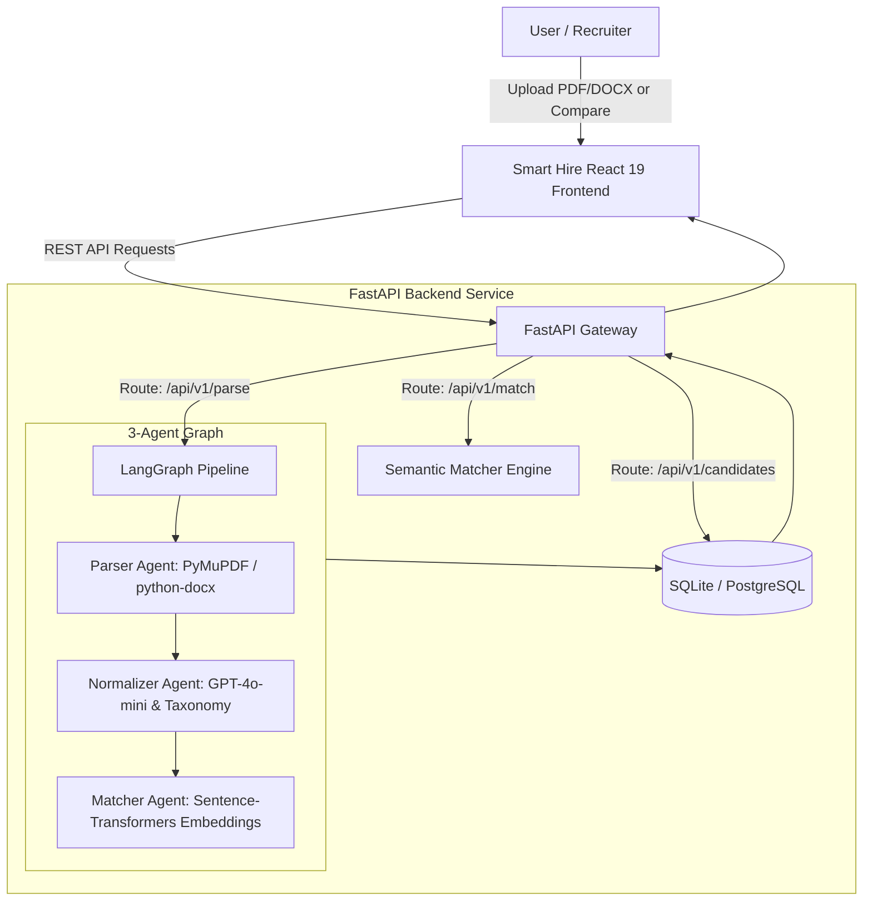

# ⚡ Smart Hire

> **Multi-Agent AI Resume Intelligence & Semantic Talent Matching Platform**  
> Orchestrated by **LangGraph**, powered by **FastAPI** + **Sentence-Transformers** + **GPT-4o**, and delivered in a dark glassmorphic dashboard built with **React 19** and **TanStack**.

---

## 🚀 Overview

**Smart Hire** is a production-grade talent acquisition and candidate evaluation platform that replaces noisy keyword search with **semantic skill retrieval and multi-agent reasoning**.

Resumes (PDF, DOCX, TXT) flow through a **3-agent LangGraph orchestration pipeline** that extracts unstructured resume content into structured JSON schemas, normalises skills against a canonical taxonomy of 3,200+ technology concepts, and computes dense embedding similarity against target job descriptions in real time.

---

## ✨ Core Highlights (Built for AI Career & Talent Matching)

### 🧠 1. Real-Time Multi-Agent Pipeline (LangGraph)
Resumes are processed through a sequential, stateful 3-agent graph:
1. **Parser Agent**: Extracts raw text from PDF and DOCX files with high fidelity using PyMuPDF and python-docx.
2. **Normalizer Agent**: Extracts structured personal info, experience, education, and projects using GPT-4o-mini with structured outputs (plus a local deterministic fallback engine for zero-cost uptime). Maps raw skill text to canonical taxonomy tags.
3. **Matcher Agent**: Computes dense vector embeddings (`all-MiniLM-L6-v2`) over candidate profiles and job requirements, calculating semantic match scores via cosine similarity and identifying matched vs. missing skills.
* **Agent Trace Monitor**: Visual pipeline that traces execution times, node states, and intermediate outputs.

### 📊 2. Candidate Compare & Leaderboard
* **Multi-Candidate Ranking**: Compare up to 50 candidates simultaneously against any role with match thresholds and top-K filters.
* **Preset & Custom Job Descriptions**: Select pre-seeded target profiles (including **Elip — Software Engineer (AI Career Agent)**) or paste custom job requirements directly.
* **Skill Gap Analysis**: Instant visual breakdown of matching skills vs. missing critical competencies.
* **Interactive Profile Viewer**: Click on any leaderboard candidate to inspect detailed experience timelines, verified skills, and project summaries, or export structured JSON.

### 🌳 3. Canonical Skill Taxonomy
* **3,200+ Canonical Skills**: Organized into searchable categories, subcategories, synonyms, and related skills.
* **Deduplication & Synonym Resolution**: Maps variants like *"ReactJS"*, *"React.js"*, and *"react"* to a single canonical skill node.

### 🛡️ 4. Production Resiliency & Architecture
* **Self-Healing SQLite Backend**: Dynamic schema migration on startup detects and backfills table columns without data loss.
* **Dual-Engine Normalization**: Automatic fallback to local text parsing if OpenAI keys are absent or rate-limited.
* **Memory-Efficient Embeddings**: Lazy-loaded sentence transformer models optimized for containerized environments.

---

## 🏗️ Architecture & Data Flow



---

## 🛠️ Tech Stack

* **Frontend**: React 19, TypeScript, TanStack Router / Start, Tailwind CSS v4, Lucide Icons, Sonner.
* **Backend**: FastAPI (Python 3.11+), LangGraph, LangChain Core, Sentence-Transformers (`all-MiniLM-L6-v2`), PyMuPDF, python-docx, SQLAlchemy, aiosqlite.
* **AI & Embeddings**: OpenAI GPT-4o-mini (structured parsing & AI recommendations), Dense Vector Embeddings (cosine similarity).
* **Database**: Unified SQLite database (`smarthire.db`) with automatic startup migrations.

---

## 🚢 Deployment Guide

Smart Hire is structured for instant separation into a **Render backend** and **Vercel frontend**.

### Part 1: Deploy Backend on Render

1. **Push your repository to GitHub.**
2. Go to [Render Dashboard](https://dashboard.render.com/) and click **New +** $\rightarrow$ **Web Service**.
3. Connect your GitHub repository.
4. Configure the Web Service settings:
   - **Name**: `smarthire-backend`
   - **Root Directory**: `backend`
   - **Environment**: `Python 3`
   - **Build Command**: `pip install -r requirements.txt`
   - **Start Command**: `uvicorn main:app --host 0.0.0.0 --port $PORT`
5. In **Advanced** $\rightarrow$ **Environment Variables**, add:
   - `OPENAI_API_KEY`: `your_openai_api_key_here`
   - `PYTHON_VERSION`: `3.11.9`
6. Click **Deploy Web Service**.
7. Once deployed, copy your Render backend URL (e.g., `https://smarthire-backend.onrender.com`).
   - Test it by visiting `https://your-backend.onrender.com/health` $\rightarrow$ should return `{"status": "healthy"}`.

*(Alternatively, you can select "Docker" as environment — a preconfigured `backend/Dockerfile` is already included).*

---

### Part 2: Deploy Frontend on Vercel

1. Go to [Vercel Dashboard](https://vercel.com/) and click **Add New...** $\rightarrow$ **Project**.
2. Import the same GitHub repository.
3. In the project configuration:
   - **Root Directory**: Click edit and choose `frontend`.
   - **Framework Preset**: TanStack Start / Vite / Other (detected automatically).
   - **Build Command**: `npm run build`
   - **Output Directory**: Leave as default (`.output` / `.vercel/output`).
4. In **Environment Variables**, add:
   - `VITE_API_URL`: Your Render backend URL from Part 1 (e.g., `https://smarthire-backend.onrender.com` without trailing slash).
5. Click **Deploy**.
6. When deployment finishes, your live Smart Hire URL is ready to share!

---

## 💻 Local Development Quickstart

### 1. Backend Setup
```bash
cd backend
python -m venv venv
source venv/bin/activate  # Windows: venv\Scripts\activate
pip install -r requirements.txt

# (Optional) Add OpenAI key for LLM parsing
cp .env.example .env  # Add OPENAI_API_KEY=...

# Seed demo candidates & Elip job description
python scripts/seed_demo.py

# Launch server
python main.py
```
Backend runs at [http://localhost:8000](http://localhost:8000). Interactive docs at `/docs`.

### 2. Frontend Setup
```bash
cd frontend
npm install
npm run dev
```
Frontend runs at [http://localhost:8080](http://localhost:8080).

---

## 📄 License
MIT License. Built with passion for high-impact AI career and talent matching products.
