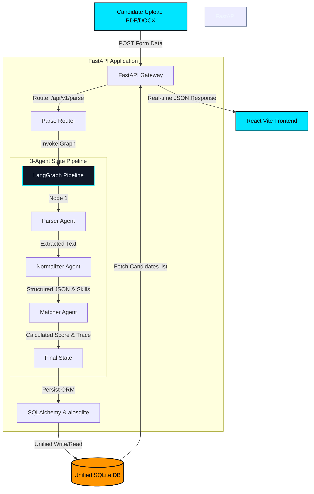

# 🌌 TalentGraph AI (Smart-Hire)

> **Mission Control meets Neural OS** — A production-grade, multi-agent AI resume intelligence, normalisation, and semantic talent matching platform.

---

## 🚀 Overview

**TalentGraph AI** is a state-of-the-art talent acquisition platform designed to automate and elevate candidate evaluation. Utilizing a **3-agent LangGraph orchestration pipeline**, TalentGraph AI processes raw resume files (PDF, DOCX, TXT), normalises skills into a canonical taxonomy, extracts deep project and experience details, and calculates semantic match scores against target jobs in real time.

All of this is wrapped in a breathtaking **"Linear-meets-Bloomberg"** glassmorphic dark-theme dashboard that turns resume analysis into an interactive data-intelligence experience.

---

## ✨ Key Features

### 🧠 1. Real-Time Multi-Agent Pipeline
* **Orchestrated by LangGraph**: Resumes are passed through a sequential 3-agent graph:
  1. **Parser Agent**: Extracts raw text from PDF and DOCX documents with extreme accuracy using PyMuPDF and python-docx.
  2. **Normalizer Agent**: Extracts personal details, experience, education, projects, and maps unstructured skills into canonical, deduplicated tags.
  3. **Matcher Agent**: Computes a semantic fit score against the target Job Description using text embeddings.
* **Agent Flow Visualization**: A dedicated "Mission Control" monitor that lets users watch the agents think, trace execution times, and view outputs of each node in real time.

### 📊 2. Rich Resume Diagnostics
* **Interactive Profile Viewer**: Clean tabbed interface to review parsed candidates:
  * **Overview**: Quick stats, contact details, and a generated executive summary.
  * **Experience**: A beautifully rendered career timeline with detailed achievements.
  * **Skills Radar**: Real-time matching taxonomy showing exact matches and missing requirements.
  * **Projects & Certs**: Interactive grid of highlighted personal/academic projects, describing technologies used and accomplishments.
* **JSON Exporter**: Download the fully-structured candidate profile JSON in one click.

### 🌳 3. Skill Taxonomy & Gap Analysis
* **Hierarchy Explorer**: Navigate the full skill tree of the organization.
* **Semantic Search**: Instantly look up canonical skills, view their metadata, and perform gap analysis comparing candidate skill sets with required job roles.

### 🛡️ 4. Bulletproof Resiliency
* **Dual-Mode Parsing Engine**: If an OpenAI API key is missing or calls are throttled, the normalizer automatically falls back to an advanced local regex-based parsing engine. This ensures **100% platform uptime** and instant, zero-cost processing for mock evaluation.
* **Self-Healing SQLite Backend**: Unified ORM and asynchronous direct query schemas. Database connections dynamically resolve absolute paths and run **automatic schema migrations** at startup to configure missing tables and columns.

---

## 🏗️ Architecture & Data Flow



---

## 🛠️ Tech Stack

* **Frontend**:
  * React (TypeScript, Vite)
  * Tailwind CSS (Custom Color Variables)
  * Framer Motion (Smooth Micro-Animations & Transitions)
  * React Router (Declarative Navigation)
* **Backend**:
  * FastAPI (Python 3.13)
  * LangGraph & LangChain (Agentic Workflows)
  * SQLite & SQLAlchemy (Unified Storage & Asynchronous direct access)
  * PyMuPDF & python-docx (Document Parsers)

---

## 🚀 Installation & Setup

### Prerequisites
* **Python 3.10+**
* **Node.js 18+**

---

### 1. Backend Setup

1. Navigate to the backend directory:
   ```bash
   cd backend
   ```

2. Create a virtual environment and activate it:
   ```bash
   python -m venv venv
   source venv/bin/activate  # On Windows use: venv\Scripts\activate
   ```

3. Install the dependencies:
   ```bash
   pip install -r requirements.txt
   ```

4. *(Optional)* Add your OpenAI API key for real-time LLM-based parsing:
   Create a `.env` file in the `backend/` directory:
   ```env
   OPENAI_API_KEY=your_openai_api_key_here
   ```
   *Note: If no API key is supplied, the backend seamlessly falls back to the local regex normalizer.*

5. Launch the FastAPI server:
   ```bash
   python main.py
   ```
   The backend will startup and self-heal the database. It is accessible at **[http://localhost:8000](http://localhost:8000)** (API Documentation available at `/docs`).

---

### 2. Frontend Setup

1. Navigate to the frontend directory:
   ```bash
   cd ../frontend
   ```

2. Install Node packages:
   ```bash
   npm install
   ```

3. Start the Vite development server:
   ```bash
   npm run dev
   ```
   The frontend application is now running at **[http://localhost:8080](http://localhost:8080)**.

---

## 💾 Database Architecture & Self-Healing Migration

TalentGraph AI uses a single unified **SQLite** database (`talentgraph.db`) located in the root of the backend folder. 

To bridge the gap between SQLAlchemy ORM transactions and direct asynchronous queries (`aiosqlite`), the backend implements a **Self-Healing Schema Migration** routine at startup:
* Automatically verifies the state of all tables (`candidates`, `job_descriptions`).
* Detects missing columns (e.g. `name`, `email` in candidate tables) and alters the SQLite database dynamically without losing data.
* Unifies database paths across both ORM and async controllers by resolving absolute file locations dynamically.

---

## 🌟 Visual Preview

* **Upload & Diagnostics Page**: Drag-and-drop resume loader. Displays execution speeds, match ratings, and fully structured candidate sheets.
* **LangGraph Flow Monitor**: Dynamic nodes representing Parser, Normalizer, and Matcher agents. Nodes animate based on the active state of processing.
* **Skill Tree Gap Matrix**: Highlighting core overlaps, matching candidates, and required skill maps.

---

## 📄 License
This project is licensed under the MIT License. Created for the **TalentGraph AI Hackathon**.
